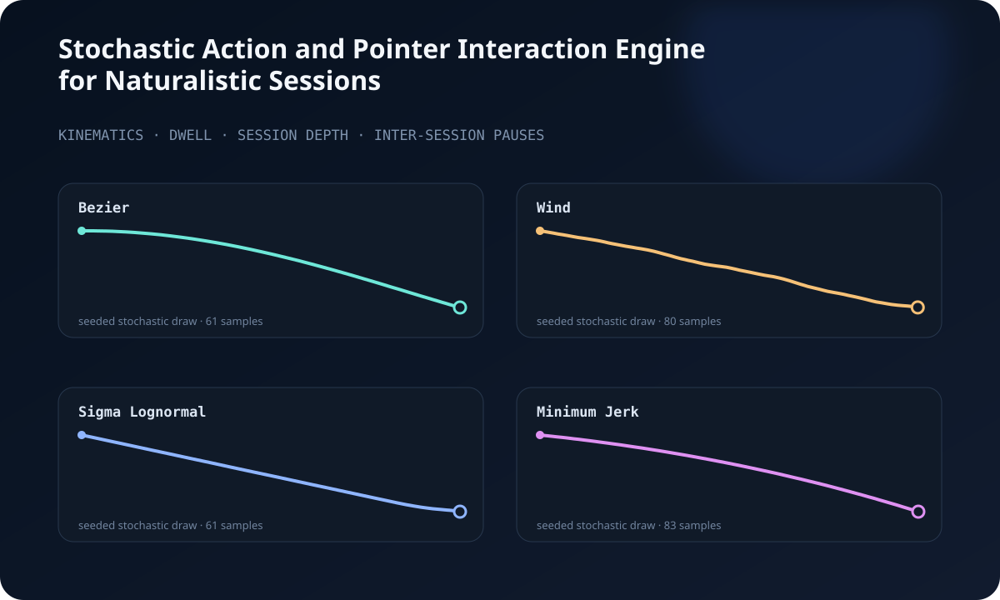

<div align="center">

# Stochastic Action and Pointer Interaction Engine for Naturalistic Sessions

A hierarchical generative model of human–web interaction dynamics.

[Methodology](docs/METHODOLOGY.md) · [Portfolio](https://omrigalor.com) · [Run the model](#run-it)

</div>



## In plain English

The engine generates complete **synthetic browsing sessions** for research and
interface testing. It models how long a cursor movement takes, what shape that
movement follows, how long someone may attend to a page, how many pages occur
before a break, and how long that break lasts. The output is reproducible test
data for evaluating interfaces and interaction analytics without recording a
real person's behavior.

## What it models

Most synthetic interaction systems model one scale well and ignore the rest. This engine treats an online session as a coupled stochastic process:

| Layer | Random variable | Model |
|---|---|---|
| Target acquisition | Movement duration | Fitts-law expectation with bounded heterogeneity |
| Pointer kinematics | Spatial and velocity path | Four-component trajectory mixture |
| Page attention | Dwell time | Weibull “screen-and-glean” process plus reading time |
| Session continuity | Pages before a break | Inverse-Gaussian session depth |
| Inter-session behavior | Pause duration | Bounded Pareto process |

The result is a reproducible generator for **simulation, interface testing, and research prototyping**. A seed reproduces the same trace; changing the seed generates another draw from the model.

## The four kinematic families

1. **Minimum jerk** — smooth reaches with bell-shaped velocity implied by minimizing integrated squared jerk.
2. **Sigma lognormal** — a primary neuromotor stroke plus an overlapping corrective submovement.
3. **Wind dynamics** — attraction to the target perturbed by autocorrelated lateral force.
4. **Bézier** — randomized curved geometry with Fitts-law duration and minimum-jerk progress.

`mixed` mode samples a family per reach, preventing every movement in a synthetic session from sharing one geometric signature.

## Run it

```bash
git clone https://github.com/omrigalor/stochastic-action-and-pointer-interaction-engine-for-naturalistic-sessions.git
cd stochastic-action-and-pointer-interaction-engine-for-naturalistic-sessions
python3 -m venv .venv
source .venv/bin/activate
pip install -e .
python -m naturalistic_interaction_engine --seed 42 --model mixed --output trace.csv
```

Or use the library directly:

```python
from naturalistic_interaction_engine import NaturalisticInteractionEngine

model = NaturalisticInteractionEngine(seed=42)
family, points = model.trajectory(
    start=(90, 120),
    end=(850, 470),
    target_width=44,
    model="mixed",
)

print(family, points[-1])
print("page dwell:", model.dwell_time(word_count=650))
print("session depth:", model.session_depth())
print("break:", model.break_time())
```

The package has no runtime dependencies.

## Inspect the assumptions

The full equations, parameter choices, research basis, and validation plan are in [the methodology note](docs/METHODOLOGY.md). The model draws on established work in motor control and web behavior, including Fitts's law, minimum-jerk movement, sigma-lognormal strokes, Weibull page dwell, and inverse-Gaussian browsing depth.

## Scope and limits

The engine is a **research prototype**, not a biometric model and not a validated digital twin of any person. Its current parameters are literature-informed assumptions that still require calibration against measured interaction data. It should not be used to identify people, make access decisions, evade platform safeguards, or claim that generated traces are indistinguishable from human traces.

## Tests

```bash
python -m pip install pytest
pytest
```

Tests cover endpoint convergence, time monotonicity, seeded reproducibility, distribution bounds, and finite velocity output.

## License

MIT © 2026 Omri Galor
